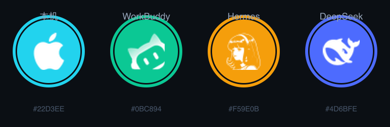

# Agent Panel · ESP32-P4 桌面状态副屏

把一块 4.3 英寸的 ESP32-P4 开发板做成常驻桌面的状态副屏，四页分别显示本机硬件状态
与三个本地 AI 智能体（WorkBuddy / Hermes Agent / DeepSeek harness）的运行情况。

横滑切换页面。数据由电脑侧一个 Python 脚本通过 USB CDC 每两秒推送一次，板子只负责显示。

> A 4.3" ESP32-P4 desk panel showing live status of local AI agents.
> Data is pushed over USB CDC as NDJSON; the board only renders.



## 它解决什么问题

同时跑几个智能体时，想知道"有没有出事"通常要切窗口、翻日志、看多个终端。
副屏的价值不是把日志搬到另一块屏上，而是**余光扫一眼就知道全局**：

- 有没有哪个智能体在等我确认
- 它此刻在跑什么命令
- 今天干了多少、什么时候最忙

所以界面刻意做得极少：一页一个主体，大字号数字，颜色即状态。

## 四个页面

| 页面 | 内容 |
|---|---|
| 本机 | Apple 芯片型号、处理器 / 内存 / 磁盘占用（三条进度条）、负载、核心数 |
| WorkBuddy | 状态、命令摘要、本轮耗时、今日操作次数、24 小时活动热力条 |
| Hermes Agent | 状态、最近调用的工具、24 小时消息数、活动热力条 |
| DeepSeek harness | 状态、会话总数、最后活动时间 |

每页都有：品牌徽章（外环为状态色，工作中呼吸）、当前任务、24 小时热力条、
以及"标识 / 数据源 / 刷新"三列小字。

顶栏常驻四个小徽章，这样滑到任意一页都能看到另外几路是否正常。

## 状态色约定

| 颜色 | 含义 |
|---|---|
| 蓝 | 工作中 |
| 绿 | 在线空闲 |
| 橙 | 等你确认（需要人工介入） |
| 灰 | 已离线 |

顶栏右侧有 `LINK OK` / `NO LINK`，用来区分"智能体真闲着"和"数据线掉了"——
这两种情况在界面上看起来一样，不标出来会误判。

## 硬件

| 项目 | 参数 |
|---|---|
| 开发板 | 微雪 ESP32-P4-WIFI6-Touch-LCD-4.3 |
| 主控 | ESP32-P4，实测 revision v3.2，双核 400 MHz |
| 屏幕 | 4.3 英寸 480×800，ST7701，MIPI-DSI 双通道 |
| 触摸 | GT911，I2C 地址 0x5D |
| 内存 | 32 MB 伪静态存储器（封装内，16 线，80 MHz） |
| 闪存 | 32 MB（兆易创新 GD25Q256） |
| 串口桥 | 沁恒 CH343（走 macOS 原生 CDC 驱动，无需装第三方驱动） |

**只需要一根 Type-C 线插 USB OTG 口**，供电、数据、烧录全部走这一根。
UART 口不接也能正常工作。

## 快速开始

### 直接用预编译固件

`firmware/` 里是编译好的镜像，不装工具链也能烧。

```sh
# 1. 板子插 USB OTG 口，按住 BOOT → 点 RESET → 松开 BOOT
# 2. 烧录
sh scripts/flash_usb.sh firmware
```

注意脚本会跳过 `AGP` 端口（那是应用模式），只认下载模式的端口。若提示找不到设备，
说明还没进入下载模式。

### 从源码编译

环境：**ESP-IDF 5.5.4**。必须是 5.5.x —— 5.5.0 的芯片版本上限是 v1.99，
这块板是 v3.2，直接用不了。

```sh
# 1. 生成字库（字体源码约 21 MB，不纳入版本库）
python3 scripts/gen_fonts.py
#    需要 lv_font_conv：npm install -g lv_font_conv

# 2. 配置与编译
. $IDF_PATH/export.sh
idf.py -B build set-target esp32p4

# 3. 首次配置后需要打开 USB CDC（详见 docs/build.md）
printf 'CONFIG_TINYUSB_CDC_ENABLED=y\n' >> sdkconfig
printf 'CONFIG_TINYUSB_DESC_PRODUCT_STRING="Agent Panel"\n' >> sdkconfig
printf 'CONFIG_TINYUSB_DESC_SERIAL_STRING="AGP001"\n' >> sdkconfig

idf.py -B build build
sh scripts/flash_usb.sh build
```

### 启动数据推送

```sh
python3 -m pip install pyserial psutil
sh scripts/start_panel.sh          # 前台
sh scripts/start_panel.sh --bg     # 后台
```

脚本会自动找端口（优先 `*AGP*`），默认每 1 秒推一次（`--interval` 可调）。采集端带断线重连，
板子复位或重新插拔后自动恢复，不需要人工重启。

状态判定按「活跃」而非时间阈值：日志增长速率抬升、审计事件刚落盘、命令已开工未返回，
任一满足即记为活跃，保持 45 秒。实测依据与取舍见 [docs/pitfalls.md](docs/pitfalls.md) 第十一节。

## 数据协议

板子从 USB CDC 读行分隔 JSON，一行一条：

```json
{"ag":"workbuddy","st":"busy","task":"执行命令","cmd":"cat >> notes.md",
 "ago":"0 秒前","el":128,"cnt":396,"csub":"今日操作","heat":"000000000000011000009033"}
```

字段说明见 [docs/protocol.md](docs/protocol.md)。板子收到后会回一行
`ACK <标识> <状态> / <任务>`，且只在状态文字变化时才回，不重复发。

超过 15 秒没收到某一路数据，固件自动判为无数据；四路全断则顶栏显示 `NO LINK`。

## 目录结构

```
├── main/                    固件源码
│   ├── main.c               界面与协议解析
│   ├── lv_img_agent_icons.c 四个徽章图标（38 与 18 像素各一套）
│   └── CMakeLists.txt       字库缺失时会给出明确报错
├── scripts/
│   ├── gen_fonts.py         生成 LVGL 点阵字库
│   ├── flash_usb.sh         通过 USB OTG 口烧录
│   └── start_panel.sh       启动采集端
├── tools/
│   └── agent_panel_daemon.py  采集端：读本机状态、推 JSON
├── assets/logos/            图标素材与来源说明
├── docs/                    构建说明、协议、踩坑记录
└── firmware/                预编译镜像
```

## 踩过的坑

这个项目在硬件与图形栈上踩了不少坑，都记在 [docs/pitfalls.md](docs/pitfalls.md)。
几个最容易复现的：

- **伪静态存储器配置被静默丢弃**：ESP-IDF 的最小构建模式下，`main` 不声明
  `PRIV_REQUIRES esp_psram` 时，`CONFIG_SPIRAM` 会被当成拼错的符号丢掉，编译
  照样成功，但 32 MB 内存对固件完全不可见。
- **图形库的 OS 后端必须成组配置**：只加 `LV_OS_FREERTOS` 而不配齐内存分配器与
  刷新周期，渲染线程会卡死——背光亮着但屏幕全黑。
- **USB 方式烧录必须关压缩**：否则报 `C900 Too much data`；而且 `idf.py flash`
  不支持 `--no-compress`，只能直接调 esptool。
- **背光是反相输出，上电即亮**：所以"屏幕点亮"不能作为程序正常运行的证据。

## 限制

- 烧录必须手动按键进入下载模式。P4 没有 `RTC_CNTL` 那套强制下载寄存器，
  `esptool --before usb_reset` 对 TinyUSB 的 CDC 设备也无效。
- Hermes 的顶栏小徽章（18 像素）偏糊——官方图标是精细肖像线稿，缩到这个尺寸
  细节留不住；页面徽章 38 像素下清晰。
- 采集端目前只适配 macOS（读 `~/.workbuddy`、`~/.hermes`、`~/.dsh` 与 `psutil`）。
  换平台需要改 `tools/agent_panel_daemon.py` 里的采集函数。

## 许可

代码以 MIT 发布，见 [LICENSE](LICENSE)。

图标与字体不在 MIT 范围内：四个品牌标识归各自权利人，仅作指明性使用；
字体遵循 SIL OFL。详见 [NOTICE](NOTICE)。
